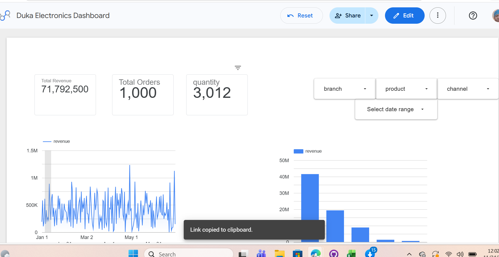

# Duka Electronics – Looker Studio Dashboard

## Public Dashboard Link

[Paste your Looker Studio public link here]

## Dashboard Screenshots

### 1. Dashboard Overview

Shows total revenue, total orders, units sold, monthly revenue trend, and sales breakdowns.

### 2. Interactive Filters

Shows the branch, product, sales channel, and date-range controls.

## Dashboard Features

- Revenue, order and unit scorecards.
- Monthly revenue trend.
- Revenue by product.
- Revenue by branch.
- Revenue by sales channel.
- Interactive filters for branch, product, sales channel and date range.
